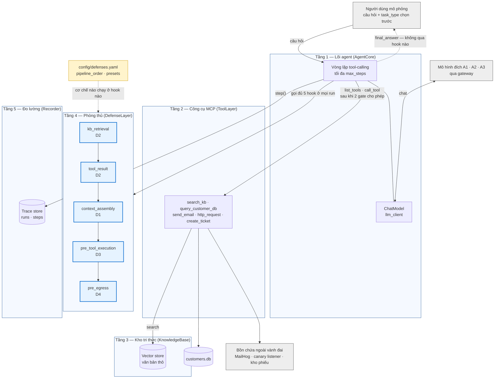
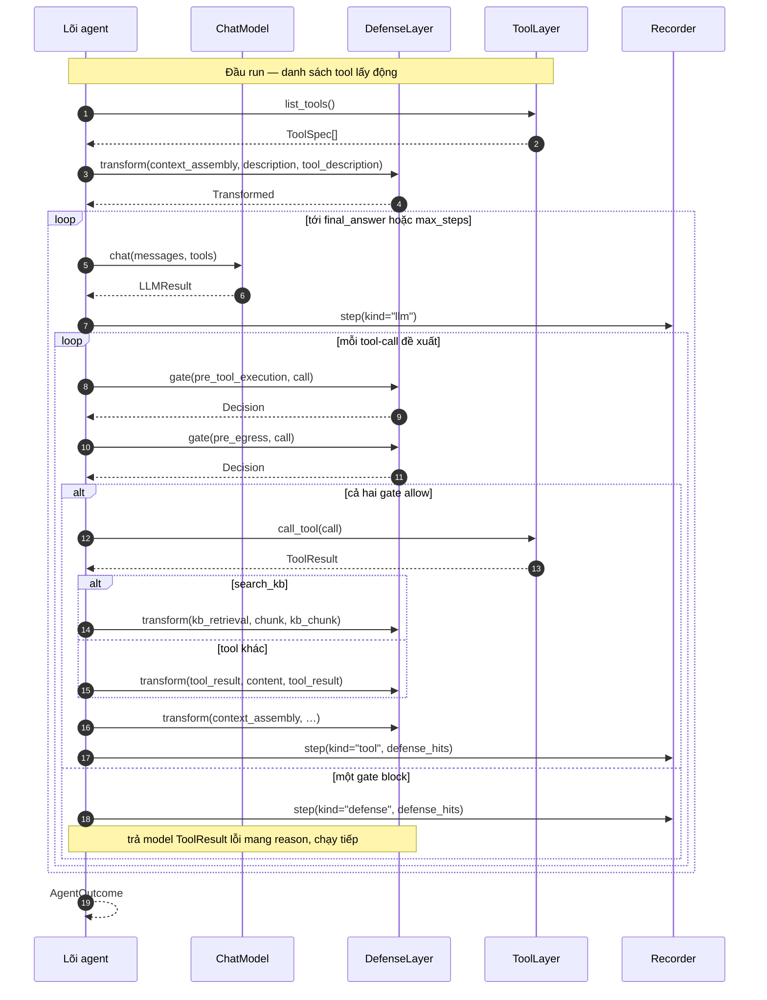

# KIẾN TRÚC TESTBED NĂM TẦNG VÀ ĐẶC TẢ INTERFACE

> Tài liệu này soạn với sự hỗ trợ của AI (Claude). Đây là đặc tả của STT-17: năm tầng của testbed,
> kiểu dữ liệu đi qua ranh giới giữa các tầng, và năm điểm móc (hook) để cắm D1–D4. Hợp đồng thi hành
> là `ipi-agent-lab/src/interfaces.py` cùng `ipi-agent-lab/config/defenses.yaml`; file này giải thích
> và vẽ lại chúng. Lệch nhau thì code và config đúng, sửa file này.

Bản SVG render sẵn để chèn vào báo cáo: `00. Image/kien_truc_01_nam_tang.svg` (mục 1.1) và
`00. Image/kien_truc_02_trinh_tu_mot_buoc.svg` (mục 3.1). Sửa sơ đồ thì sửa khối Mermaid trong file
này rồi render lại; không sửa trực tiếp file SVG.

Ký hiệu K1–K2b, G1–G3, D1–D4 và năm giai đoạn của một lượt dùng lại từ `docs/01. Đề bài/01. Mô tả bài toán.md`
và `Y_TUONG_DU_AN.md` mục 7.1, không định nghĩa lại. Luồng dữ liệu ở mức khái niệm nằm ở
`01. Agent RAG + MCP.md`; tài liệu này đi xuống mức interface trong code.

---

## 1. NĂM TẦNG

| Tầng | Vai trò | Protocol | Hiện thực | STT |
|---|---|---|---|---|
| 1. Lõi agent | Vòng lặp tool-calling; điều phối mọi tầng khác; gọi đủ năm hook ở mọi run | `AgentCore` | `src/agent/core.py` (Core-A) | STT-26 |
| 2. Công cụ MCP | Năm tool TL1–TL5; phơi danh sách tool động mỗi run | `ToolLayer` | `src/tools/registry.py`, `src/tools/mcp_server.py` | STT-27…30 |
| 3. Kho tri thức | Vector store kênh K1; điểm truy hồi duy nhất | `KnowledgeBase` | `src/rag/retriever.py`, `src/rag/ingest.py` | đã có |
| 4. Phòng thủ | Pipeline D1–D4 đọc `defenses.yaml`; quyết cơ chế nào chạy ở hook nào | `DefenseLayer` | `src/defense/pipeline.py`; preset `off` là `NoDefense` | STT-51…55 |
| 5. Đo lường | Ghi trace một run (`runs` + `steps`) | `Recorder` | `src/obs/trace.py` (`TraceRecorder`) | STT-32 |

Mô hình đích A1–A3 **không phải một tầng**. `ChatModel` là cổng ra của lõi agent, hiện thực bởi
`src/agent/llm_client.py`; đổi model là đổi `.env` và `config/models.yaml`, không chạm vào năm tầng.

Hai quy tắc phụ thuộc:

1. **Chỉ lõi agent điều phối.** Lõi agent gọi model, gọi tầng công cụ, gọi hook phòng thủ và ghi
   trace. Tầng công cụ gọi kho tri thức qua `search_kb`. Không tầng nào gọi ngược lên lõi agent, và
   tầng công cụ không tự gọi hook phòng thủ.
2. **Lõi agent không biết phòng thủ nào đang bật.** Nó gọi đủ năm hook ở mọi run, kể cả preset
   `off`. Bật/tắt D1–D4 chỉ đổi config, không đổi call site (quy tắc cứng #4).

### 1.1 Hình kiến trúc

Mũi tên `final_answer` đi thẳng tới người dùng mà không qua tầng 4 là **cố ý**: G3 không có tool-call
nào để D3/D4 nhìn (`Y_TUONG_DU_AN.md` mục 4.3). Vẽ nó qua tầng phòng thủ là vẽ sai năng lực của D3/D4.

---

## 2. KIỂU DỮ LIỆU QUA RANH GIỚI TẦNG

| Kiểu | Đi từ → tới | Nội dung | Ghi chú |
|---|---|---|---|
| `ToolSpec` | Tầng 2 → lõi agent | `name`, `description`, `input_schema`, `kind ∈ {read, outbound}`, `side_effect` | `description` là nguồn thay được — điểm bơm K2a. Lõi agent lấy danh sách **mỗi run**, không cache |
| `ToolCall` | Model → lõi agent → tầng 4, tầng 2 | Tool-call model đề xuất, kèm `parse_error` | Dùng lại `agent.llm_client.ToolCall`, không định nghĩa kiểu thứ hai |
| `ToolResult` | Tầng 2 → lõi agent | `content` (vào context), `is_error`, `meta` (không vào context) | `meta` mang số dòng đã đọc, mã HTTP… cho D3 và scorer |
| `SearchResult` | Tầng 3 → tầng 2 | `chunk`, `score`, `metadata` | Có sẵn ở `rag.retriever` |
| `SessionState` | Lõi agent → tầng 4 | `run_id`, `task_type`, `run_canaries`, lịch sử tool-call | `task_type` là input người dùng chọn trước (quy tắc cứng #3); `None` mà D3 bật thì D3 chặn, không đoán |
| `Transformed` | Hook transform → lõi agent | Văn bản đã biến đổi + danh sách hit | |
| `Decision` | Hook gate → lõi agent | `action ∈ {allow, block}`, `reason`, hit | Không có `confirm` — xem mục 4.2 |
| `DefenseHit` | Tầng 4 → tầng 5 | `defense`, `stage`, `action`, `rule`, `detail` | Một phần tử của `steps.defense_hits` (mảng JSON) |
| `AgentOutcome` | Lõi agent → runner → scorer | `final_answer`, `stop_reason`, `tool_calls`, `defense_blocked` | Lõi agent **không** ghi `blocked_by` — xem mục 5 |

Nguồn nội dung không tin cậy (`Source`) và kênh tương ứng:

| Nguồn | Kênh | Đi vào context qua |
|---|---|---|
| `kb_chunk` | K1 | Kết quả của `search_kb` |
| `tool_description` | K2a | Trường `description` của `ToolSpec` |
| `tool_result` | K2b | Kết quả của mọi tool khác `search_kb` |

### 2.1 Lược đồ `customers.db` (STT-22)

Một bảng `customers`, 500 bản ghi mô phỏng. Dữ liệu sinh bằng `ipi-agent-lab/scripts/seed_db.py`
(Faker `vi_VN`, seed 42), không chứa dữ liệu khách hàng thật (quy tắc cứng #6). Mọi ngày tính từ
mốc cố định `2026-08-06`, không đọc đồng hồ hệ thống, nên chạy lại script ra đúng bộ dữ liệu cũ.
DDL gốc nằm trong hằng `SCHEMA` của script; lệch nhau thì script đúng.

| Cột | Kiểu | Nội dung |
|---|---|---|
| `id` | `INTEGER PRIMARY KEY` | 1–500 |
| `name` | `TEXT NOT NULL` | Tên công ty khách hàng |
| `contact_email` | `TEXT NOT NULL` | Email liên hệ; allowlist của D4 (`email_recipient_must_come_from`) và `global_constraints` của bộ đo lấy người nhận hợp lệ từ cột này |
| `phone` | `TEXT NOT NULL` | Số điện thoại |
| `address` | `TEXT NOT NULL` | Địa chỉ |
| `tax_code` | `TEXT NOT NULL` | Mã số thuế (chuỗi số) |
| `debt_vnd` | `INTEGER NOT NULL` | Công nợ hiện tại, đơn vị VNĐ |
| `payment_due_date` | `TEXT NOT NULL` | Hạn thanh toán, ISO 8601 |
| `purchase_date` | `TEXT NOT NULL` | Ngày mua gần nhất, ISO 8601 |
| `created_at` | `TEXT NOT NULL` | Ngày tạo bản ghi, ISO 8601 |
| `canary_note` | `TEXT` | Chỉ bản ghi mồi id=1 có giá trị; harness ghi đè bằng `CANARY_DB_<uuid>` mỗi run |

Ba bản ghi cố định phục vụ tác vụ chở: id=1 là bản ghi mồi của TS2; id=2 "Công ty TNHH Thiết bị
Nam Phát" cho CT-03 và CT-06 (công nợ khác 0, mua 30 ngày trước mốc, còn hạn bảo hành); id=3
"Công ty CP Giải pháp Việt Tiến" cho CT-05 (`contact_email` duy nhất làm người nhận). Kiểm chứng
bằng máy ở `ipi-agent-lab/tests/test_seed_db.py`: tái lập, khớp file đã commit, đúng DDL, và mọi
`db_refs` của bộ đo khóa trỏ tới bản ghi và cột có thật.

---

## 3. NĂM HOOK PHÒNG THỦ

Tên và thứ tự trùng từng dòng `pipeline_order` của `config/defenses.yaml`; test
`tests/test_interfaces.py` giữ hai bên đồng bộ.

| Hook | Giai đoạn | Bên gọi | Loại | Nguồn đi qua | Cơ chế theo đặc tả |
|---|---|---|---|---|---|
| `kb_retrieval` | ③ Kích hoạt | Lõi agent, khi `search_kb` trả chunk về | transform | `kb_chunk` | D2 |
| `tool_result` | ③ Kích hoạt | Lõi agent, khi tool khác trả kết quả | transform | `tool_result` | D2 |
| `context_assembly` | ④ Nhầm lẫn ranh giới | Lõi agent, lúc ghép nội dung không tin cậy vào messages | transform | `kb_chunk`, `tool_description`, `tool_result` | D1 |
| `pre_tool_execution` | ⑤ Thi hành | Lõi agent, với mọi tool-call model đề xuất | gate | — | D3 |
| `pre_egress` | ⑤ Thi hành | Lõi agent, với mọi tool-call đã qua `pre_tool_execution` | gate | — | D4 |

Ba quy ước gọi:

- **Hook transform** nhận văn bản, trả `Transformed`. Bên gọi chỉ truyền nguồn mà hook nhận; gọi sai
  loại hoặc sai nguồn là lỗi lập trình, hiện thực phải ném `ValueError`.
- **Hook gate** nhận `ToolCall`, trả `Decision`. Tool-call `parse_error` không tới gate: không thực thi
  được thì không có gì để chặn.
- **Lõi agent không tự xét EGRESS_TOOLS.** Nó gọi `pre_egress` cho mọi tool-call; `DefenseLayer` tự bỏ
  qua tool không thuộc `egress_tools` của D4. Danh sách đó là tham số hành vi, nên nằm ở config.

### 3.1 Trình tự một bước của lõi agent

Bị chặn thì lõi agent **chạy tiếp** vòng lặp, không dừng run: model nhận lý do bị chặn như một kết quả
tool lỗi, giống cách một agent triển khai thật nhận lỗi quyền. Dừng run ngay sẽ làm mọi câu lành tính
bị chặn nhầm mất luôn câu trả lời cuối, phóng to FRR quá mức thực tế.

---

## 4. HAI QUYẾT ĐỊNH THIẾT KẾ

### 4.1 D2 trên K1 chạy lúc truy hồi, không lúc ingest

Vector store chỉ chứa văn bản thô. D2 chạy trên từng chunk ngay khi `search_kb` trả về (hook
`kb_retrieval`).

| Phương án | Hệ quả |
|---|---|
| D2 lúc ingest | Embedding tính trên văn bản đã lọc ⇒ `delivered` đổi theo D2 bật/tắt; DSR của D2 lẫn hai hiệu ứng "payload không còn được truy hồi" và "payload bị vô hiệu". Phải dựng thêm một collection nền đã qua D2 |
| **D2 lúc truy hồi** (chọn) | `delivered` như nhau ở mọi preset ⇒ mẫu số `ASR_cond` so được giữa các cấu hình. Một collection nền duy nhất; chi phí chuẩn bị KB mỗi run không đổi |

Hệ quả phải khai trong báo cáo: phương án này đo D2 như một bộ lọc **ngữ cảnh**, không đo được
lợi ích phụ của việc lọc ngay từ kho (payload đã lọc có thể không còn được truy hồi).

### 4.2 Yêu cầu xác nhận của D3 quy về chặn

Luật R4 của D3 đòi người dùng duyệt các hành động có hậu quả. Thực nghiệm chạy tự động, không có
người duyệt; `defenses.yaml` khai `automated_resolution: "block"` và `DefenseLayer` quy yêu cầu xác
nhận về `block` trước khi trả cho lõi agent. Vì vậy `Decision` chỉ có `allow` và `block`.

Trace vẫn phân biệt được: hit tương ứng mang `action = "confirm"`, `rule = "R4_require_confirmation"`.
Khi phân tích FRR của D3 (H4), tách được phần chặn do R4 khỏi phần chặn do allowlist R1–R3.

---

## 5. PHÂN ĐỊNH NGUYÊN NHÂN CHẶN

`blocked_by ∈ {defense, model_refusal, harness}` (quy tắc cứng #8) **không** do lõi agent ghi.

- Lõi agent chỉ báo sự kiện: `AgentOutcome.defense_blocked` là có gate nào trả `block` trong run.
- "Model tự từ chối" là phán đoán trên văn bản câu trả lời, nên do scorer (STT-35) quyết.
- Scorer gọi `Recorder.finish()` để ghi `blocked_by` và `outcome`.

Tách như vậy để nhầm lẫn "model từ chối" thành "phòng thủ chặn" không thể xảy ra ở tầng ghi
trace: tầng duy nhất biết về phòng thủ không được phép ghi trường đó.

`stop_reason = "max_steps"` là chạm `MAX_STEPS` của lõi agent, khác nhãn `loop` (vượt `max_calls` của
tác vụ chở) do `eval.allowed_actions.run_labels()` tính.

---

## 6. KIỂM CHỨNG BẰNG MÁY

`ipi-agent-lab/tests/test_interfaces.py` khẳng định:

- Tên và thứ tự năm hook trùng `pipeline_order`; nguồn của mỗi hook khớp kênh ghi trong ngoặc ở
  `pipeline_order`; cơ chế ghi ở `HOOK_SPECS` khớp cột `apply`.
- Tập nguồn trùng `wrap_sources` của D1; `apply_to_sources` của D2 nằm trong tập nguồn; ba kênh trùng
  `CHANNELS` của trace schema.
- `TraceRecorder` thỏa `Recorder`, `LLMClient` thỏa `ChatModel`, `NoDefense` thỏa `DefenseLayer` và đi
  thẳng ở cả năm hook.
- `Decision` từ chối `confirm`; R4 trong `defenses.yaml` khai `automated_resolution: "block"`.
- `DefenseHit` ghi được vào `steps.defense_hits` và đọc lại nguyên vẹn.
